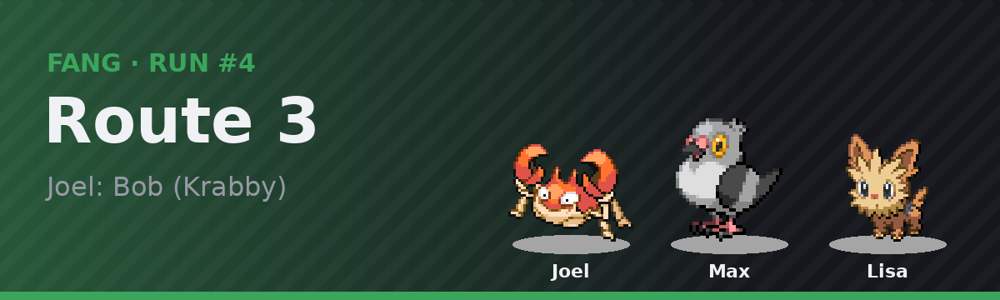
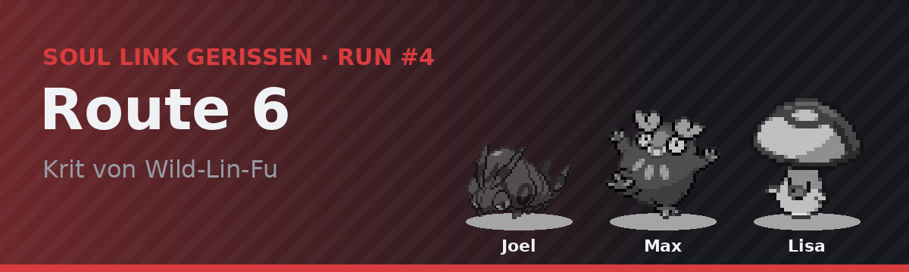
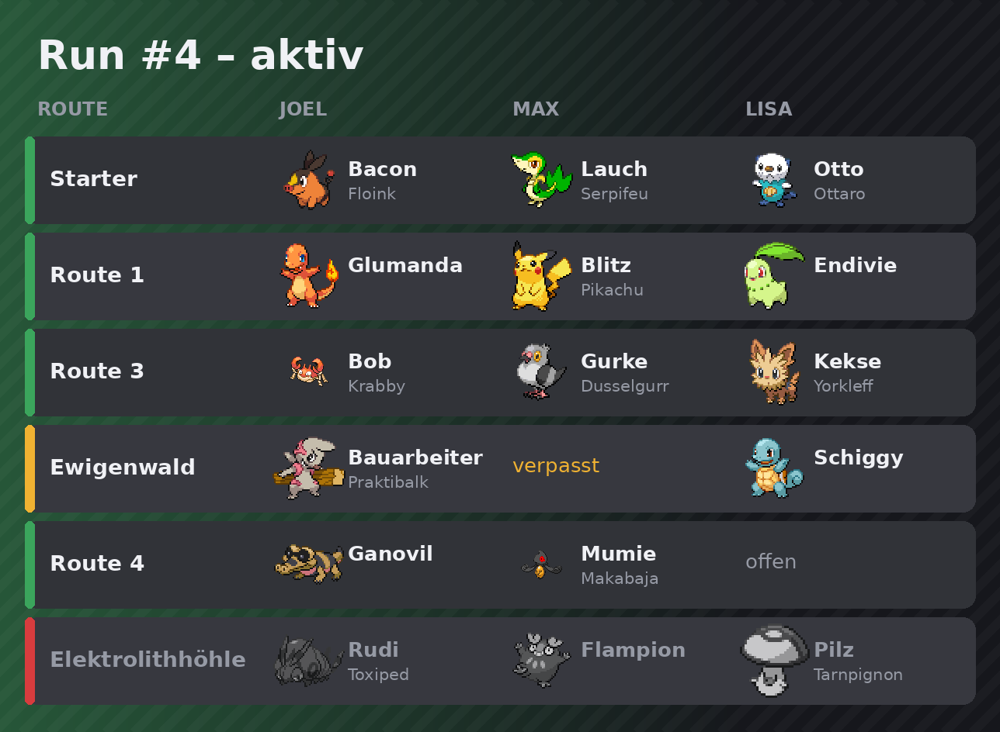
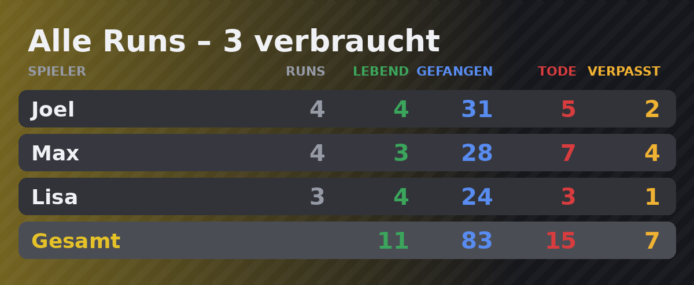
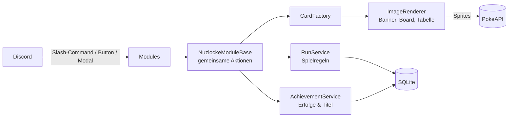
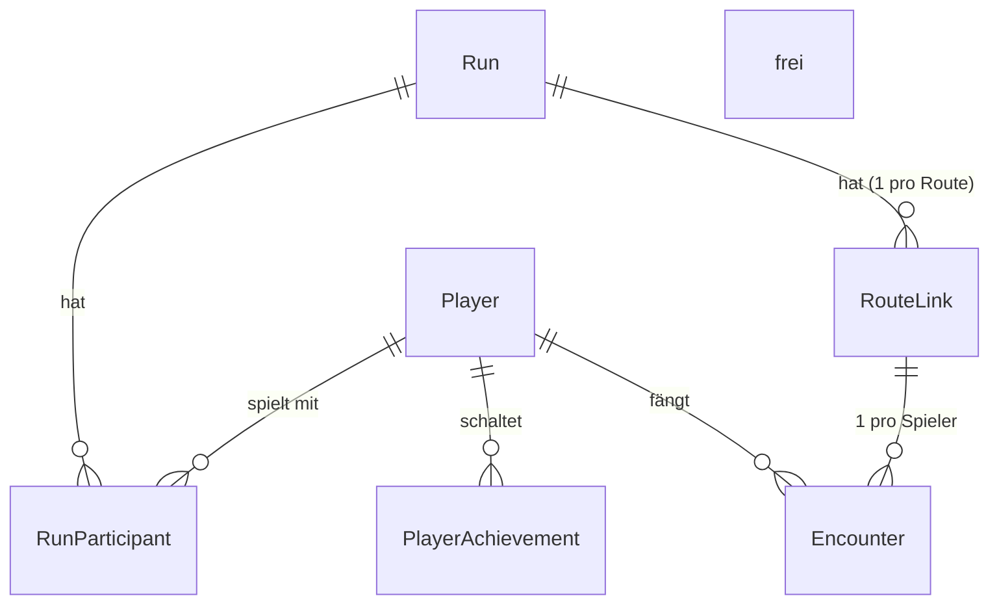

# Nuzlocke Soul-Link Bot


Ein Discord-Bot, der eine **Pokémon-Schwarz-Nuzlocke-Randomizer-Challenge im Soul-Link-Modus** für eine
Gruppe von Spielern dokumentiert – mit Regelprüfung, Statistiken, Erfolgen und zur Laufzeit generierten Bildern.

> **Soul Link:** Jeder spielt seinen eigenen Spielstand, aber die Pokémon derselben Route sind über alle
> Spieler verknüpft. Stirbt eins, sterben alle Partner auf dieser Route.

<!--
  Screenshots: Bilder in den Ordner docs/ legen und die Dateinamen hier anpassen.
  Gute Motive: ein Fang- oder Tod-Banner, /status (Board), /tabelle global, das /menu-Bedienfeld.
-->
<p align="center">
  
  
</p>
<p align="center">
  
  
</p>

---

## Features

- **Soul-Link-Logik** – Fänge, verpasste Encounter und Tode werden pro Route über alle Spieler verknüpft.
  Ein Tod beendet automatisch den ganzen Link, ein verpasster Encounter macht die Partner unbrauchbar.
- **Regelprüfung** – nur ein Encounter pro Route und Spieler, nur gültige Routen und nur Pokémon,
  die es in Schwarz gibt (alle 649). Bei Vertippern schlägt der Bot ähnliche Namen vor.
- **Run-Verwaltung** – Runs starten und beenden, verbrauchte Runs zählen, Historie aller Versuche.
- **Generierte Bilder** – Banner mit den Sprites aller Soul-Link-Partner, ein Status-Board pro Run und
  große Statistik-Tabellen, gezeichnet zur Laufzeit.
- **Statistiken** – pro Run und über alle Runs: lebende Pokémon, Fänge, ausgelöste Tode, verpasste Encounter.
- **16 Erfolge & 5 Titel** – z. B. *Legendär*, *Blitzkrieg*, *Wipe-Verursacher*; Titel wie *Pechvogel*
  wandern automatisch zum aktuell Führenden.
- **Zwei Bedienwege** – Slash-Commands mit Autocomplete oder ein Bedienfeld mit Buttons,
  Auswahlmenüs und Formularen (`/menu`).
- **Eigene Routen** – z. B. für Static- oder Geschenk-Pokémon, für alle Spieler sichtbar.
- **Korrekturen** – Vertipper und versehentliche Tode lassen sich rückgängig machen.

## Tech-Stack

| Bereich | Technologie |
|---|---|
| Sprache / Runtime | C#, .NET 10 |
| Discord | [Discord.Net](https://github.com/discord-net/Discord.Net) – Slash-Commands, Autocomplete, Buttons, Modals |
| Datenbank | SQLite mit Entity Framework Core |
| Bilder | [ImageSharp](https://github.com/SixLabors/ImageSharp) + ImageSharp.Drawing |
| Sprites | [PokeAPI/sprites](https://github.com/PokeAPI/sprites) (zur Laufzeit geladen, gecacht) |
| Hosting | Linux-Container (Proxmox LXC) als systemd-Dienst |

## Architektur



### Datenmodell



Ein **`RouteLink`** ist der Soul Link einer Route in einem Run. Er bündelt die Encounter aller Spieler und hat
einen Status (*lebendig*, *gebrochen*, *tot*). Dadurch reicht ein einziger Statuswechsel, damit alle Partner sterben.

### Designentscheidungen

- **Regeln in der Datenbank abgesichert** – eindeutige Indizes (eine Route pro Run, ein Encounter pro Spieler
  und Route) verhindern doppelte Einträge auch bei gleichzeitigen Eingaben.
- **Eine Logik, zwei Oberflächen** – Slash-Commands und Bedienfeld rufen dieselben Methoden in
  `NuzlockeModuleBase` auf, statt Logik doppelt zu pflegen.
- **Fehler für Nutzer vs. Bugs** – Regelverstöße werfen eine `NuzlockeException` und erscheinen nur für den
  Aufrufer; unerwartete Fehler werden zentral geloggt.
- **Bilder mit Fallback** – Discord verlangt eine Antwort innerhalb von 3 Sekunden. Der Bot bestätigt deshalb
  zuerst, rendert dann und reicht das Bild nach. Schlägt das Rendern fehl, kommt die Nachricht als Text.
- **Minimale Rechte** – keine privilegierten Gateway-Intents, der Bot liest keine Nachrichteninhalte.

## Commands

<details>
<summary><b>Alle Commands anzeigen</b></summary>

| Command | Zweck |
|---|---|
| `/menu` | Bedienfeld mit Buttons posten |
| `/spieler beitreten [name]` · `verlassen` · `liste` | Mitspieler verwalten |
| `/run start` · `/run ende ergebnis [grund]` · `/run liste` | Runs verwalten, Historie anzeigen |
| `/fang route pokemon [spitzname]` | Fang eintragen |
| `/verpasst route [pokemon]` | Encounter verpasst → Soul Link gebrochen |
| `/tod route ursache` | Pokémon gestorben → ganzer Soul Link tot |
| `/status [run]` | Board mit allen Routen und Pokémon |
| `/friedhof [run]` | Alle toten Soul Links |
| `/tabelle run [nummer]` · `/tabelle global` | Statistik pro Spieler |
| `/erfolge [spieler]` · `/titel` | Erfolge und aktuelle Titelträger |
| `/route erstellen name` · `loeschen` · `liste` | Eigene Routen (Statics, Geschenke) |
| `/korrektur fang-loeschen route` · `tod-zuruecknehmen route` | Fehler korrigieren |

</details>

<details>
<summary><b>Alle Erfolge anzeigen</b></summary>

| Erfolg | Bedingung |
|---|---|
| 🎣 Erster Fang · 📦 Hamster · 📕 Pokédex-Forscher | 1 · 25 · 100 Fänge |
| 🐉 Legendär | Legendäres oder mysteriöses Pokémon gefangen |
| 🌱 Starter-Sammler | Starter einer beliebigen Generation gefangen (nicht am Start) |
| 🗺️ Entdecker | Fang auf einer eigenen Route |
| 👥 Volles Team | 6 lebende Soul Links gleichzeitig |
| ⚰️ Willkommen im Club · 🪦 Totengräber | 1 · 10 ausgelöste Tode |
| ⚡ Blitzkrieg | Tod auf einer der ersten 3 Routen eines Runs ausgelöst |
| 💥 Wipe-Verursacher | Letzten Tod eines gescheiterten Runs ausgelöst |
| 🏃 Fluchtmagnet | 3 verpasste Encounter in einem Run |
| 🧊 Eiskalt | Run mit mind. 8 Routen beendet, ohne selbst einen Tod auszulösen |
| 🔁 Stammgast · 🧱 Unkaputtbar | 5 · 10 Runs gespielt |
| 🏆 Champion | Run geschafft |

**Titel:** 💀 Pechvogel · 🎣 Meisterfänger · 🙈 Grobmotoriker · 🛡️ Schutzengel · 🏅 Trophäenjäger

</details>

## Projektstruktur

```
├── Program.cs                     Start, Dependency Injection, Command-Registrierung, Fehlerbehandlung
├── Data/
│   ├── Entities.cs                Datenmodell
│   ├── NuzlockeDbContext.cs       EF Core, Indizes, Schema-Upgrade
│   ├── Pokedex.cs                 Alle 649 Pokémon aus Schwarz (deutsche Namen)
│   └── Routes.cs                  Routen von Pokémon Schwarz
├── Services/
│   ├── RunService.cs              Spiellogik und Regeln
│   ├── AchievementService.cs      Erfolge und Titel
│   ├── ImageRenderer.cs           Zeichnet Banner, Boards und Tabellen
│   ├── CardFactory.cs             Kombiniert Embed + Bild zu einer Nachricht
│   └── Formatting.cs              Texte und Embeds
├── Modules/                       Slash-Commands, Buttons, Modals, Autocomplete
└── Assets/Fonts/                  Schriftart für die Bilder
```

## Einrichtung

### 1. Discord-Bot anlegen

1. Im [Discord Developer Portal](https://discord.com/developers/applications) eine **New Application** erstellen
2. Reiter **Bot** → **Reset Token** → Token kopieren (geheim halten!)
3. Reiter **OAuth2 → URL Generator**: Scopes `bot` + `applications.commands`, Permission `Send Messages`
4. Den generierten Link öffnen und den Bot auf den Server einladen

### 2. Lokal starten

Voraussetzung: [.NET 10 SDK](https://dotnet.microsoft.com/download)

Datei `Properties/launchSettings.json` anlegen (ist in `.gitignore` und wird nicht committet):

```json
{
  "profiles": {
    "NuzlockeBot": {
      "commandName": "Project",
      "environmentVariables": {
        "DISCORD_TOKEN": "dein-bot-token",
        "DISCORD_GUILD_ID": "deine-server-id"
      }
    }
  }
}
```

```bash
dotnet run
```

| Variable | Pflicht | Bedeutung |
|---|---|---|
| `DISCORD_TOKEN` | ja | Bot-Token |
| `DISCORD_GUILD_ID` | nein | Commands nur auf diesem Server registrieren – sofort sichtbar |
| `NUZLOCKE_DB` | nein | Pfad zur SQLite-Datei (Standard: `nuzlocke.db`) |

### 3. Auf einem Linux-Server betreiben (z. B. Proxmox LXC)

```bash
# Auf dem Entwicklungsrechner: eigenständig lauffähig bauen (.NET muss auf dem Server nicht installiert sein)
dotnet publish -c Release -r linux-x64 --self-contained -o ./publish
```

Auf dem Server (Debian):

```bash
apt install -y libicu-dev
# Inhalt von ./publish nach /opt/nuzlockebot kopieren, dann:
printf 'DISCORD_TOKEN=...\nDISCORD_GUILD_ID=...\n' > /opt/nuzlockebot/bot.env
chmod 600 /opt/nuzlockebot/bot.env
```

`/etc/systemd/system/nuzlockebot.service`:

```ini
[Unit]
Description=Nuzlocke Discord Bot
After=network-online.target
Wants=network-online.target

[Service]
WorkingDirectory=/opt/nuzlockebot
ExecStart=/opt/nuzlockebot/NuzlockeBot
EnvironmentFile=/opt/nuzlockebot/bot.env
Restart=always
RestartSec=10

[Install]
WantedBy=multi-user.target
```

```bash
systemctl enable --now nuzlockebot
journalctl -u nuzlockebot -f   # Logs ansehen
```

## Danksagungen & Lizenzen

- Sprites: [PokeAPI/sprites](https://github.com/PokeAPI/sprites) – werden nicht im Repository gespeichert
- Schriftart: [DejaVu Sans](https://dejavu-fonts.github.io/) (freie Lizenz, siehe `Assets/Fonts/LICENSE_DEJAVU`)
- [ImageSharp](https://github.com/SixLabors/ImageSharp) unter der Six Labors Split License (kostenlos für Open Source)
- Pokémon und alle zugehörigen Namen sind Marken von Nintendo, Game Freak und The Pokémon Company.
  Dies ist ein nicht-kommerzielles Fan-Projekt ohne Verbindung zu diesen Unternehmen.

## Lizenz

[MIT](LICENSE)
